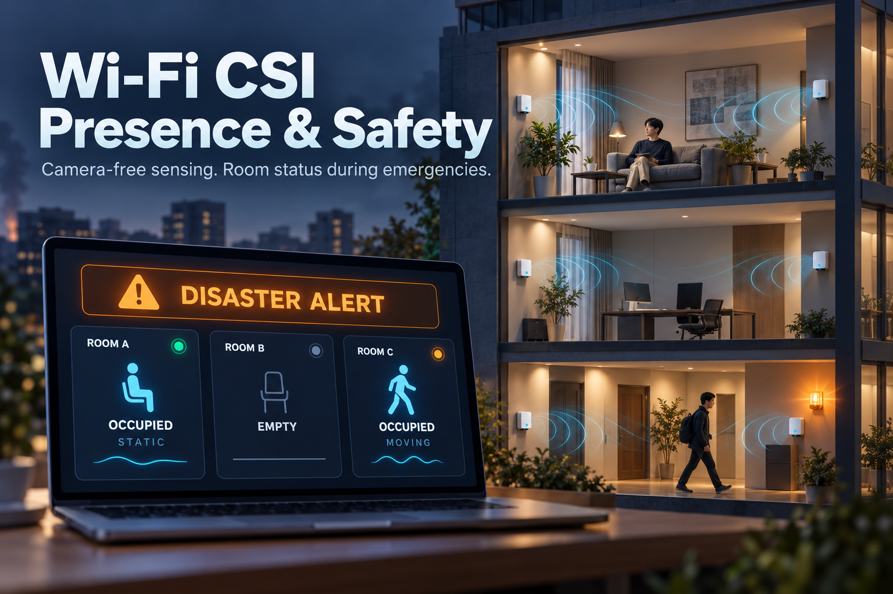
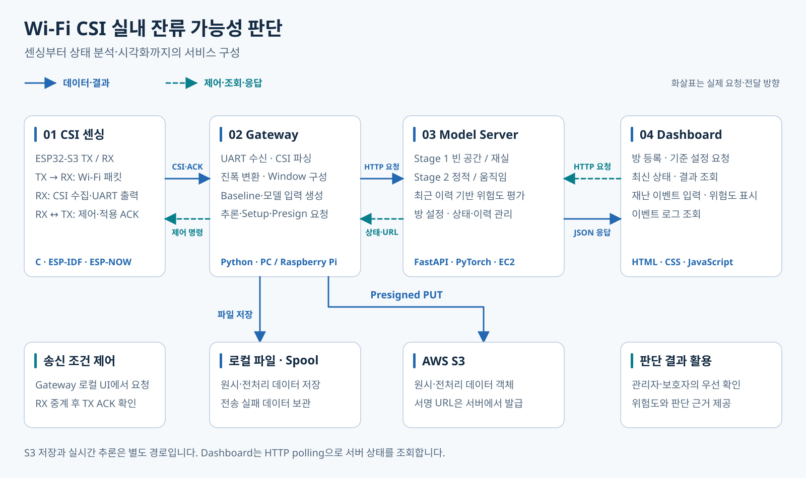
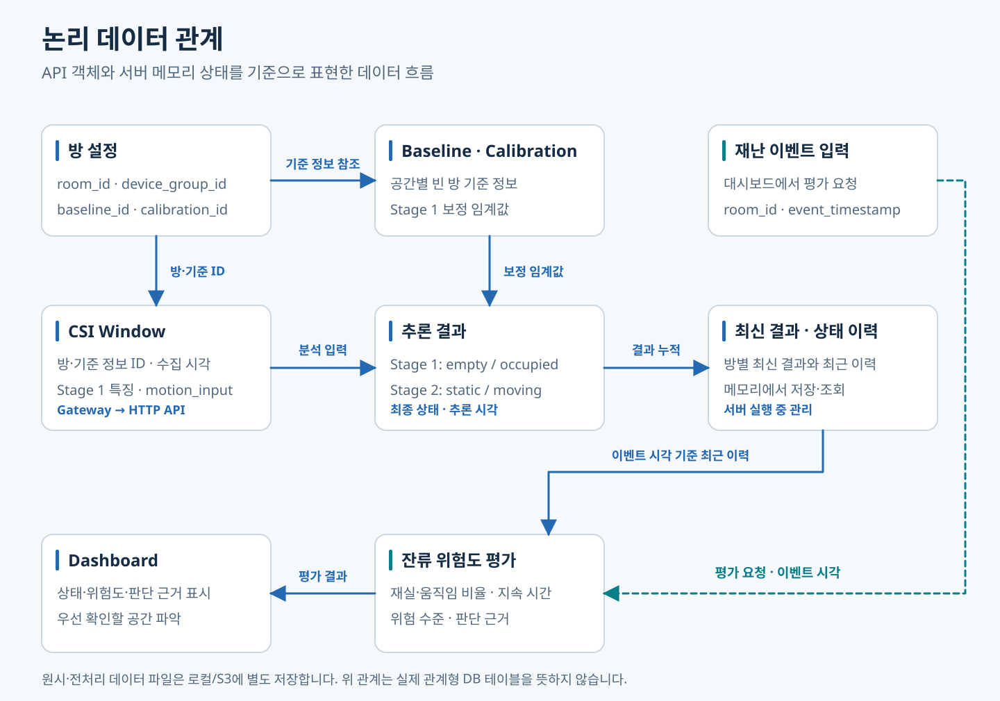

# 📝[대피 취약계층의 실내 잔류 가능성 판단 시스템]

## **💡1. 프로젝트 개요**

**1-1. 프로젝트 소개**

- 프로젝트 명 : 대피 취약계층의 실내 잔류 가능성 판단 시스템
- 프로젝트 정의 : Wi-Fi CSI(Channel State Information)로 실내 재실 여부와 정적·움직임 상태를 분석하고, 잔류 가능성이 있는 공간의 우선 확인을 돕는 안전 관리 보조 시스템입니다.



**1-2. 개발 배경 및 필요성**

- 재난 초기에는 제한된 시간과 인력으로 대피 취약자가 실내에 남아 있는지 확인해야 합니다. 영상 촬영이나 기기 착용 없이 무선 채널의 변화를 분석하여, 관리자와 보호자가 우선 확인할 공간을 파악할 수 있도록 개발했습니다.

**1-3. 프로젝트 특장점**

- **비접촉·무착용 감지** : 카메라 촬영과 사용자 장치 착용 없이 Wi-Fi CSI를 활용합니다.
- **공간별 기준 설정** : 빈 방 Baseline과 Calibration으로 설치 공간의 특성을 반영합니다.
- **2단계 상태 판단** : Stage 1에서 빈 공간/재실을 구분하고, 재실인 경우에만 Stage 2에서 정적/움직임 상태를 분류합니다.
- **이력 기반 판단** : 재난 이벤트 입력 시 최근 상태 이력을 평가하여 잔류 가능성, 위험 수준과 판단 근거를 제공합니다. 데이터가 부족하면 판단 불가로 처리합니다.

**1-4. 주요 기능**

- **CSI 수집·전처리** : ESP32-S3의 CSI를 UART로 수신하고, 진폭 변환·정규화·Window 구성을 거쳐 모델 입력을 생성합니다.
- **송신 조건 제어** : Gateway 로컬 UI에서 TX의 전송률과 송신 전력 상한을 설정하고, RX 중계와 TX ACK로 적용 결과를 확인합니다.
- **공간 설정·상태 분석** : 방 등록, Baseline 수집, Calibration, 임계값 기반 재실 판단과 1D CNN 기반 정적/움직임 분류를 수행합니다.
- **잔류 위험도·상태 표시** : 최근 재실 비율, 정적·움직임 비율과 지속 시간 등을 규칙으로 평가하고, 대시보드에 상태·위험도·이벤트 로그를 표시합니다.
- **데이터 저장·전송 실패 대응** : 원시·전처리 데이터를 로컬과 설정된 S3에 저장하며, 전송 실패 데이터는 로컬 Spool에 보관합니다.

**1-5. 기대 효과 및 활용 분야**

- 기대 효과 : 대피 취약자의 실내 잔류 가능성을 확인하기 위한 보조 정보를 제공하여, 현장 확인 순서와 초기 대응 우선순위 결정을 지원합니다.
- 활용 분야 : 주거·돌봄시설·공공시설 등의 실내 안전 모니터링과 비접촉 센싱 연구에 활용할 수 있습니다.

본 시스템은 재난 발생, 생체 상태 또는 실제 대피 완료 여부를 확정하지 않습니다. 설치 공간과 측정 조건에 따른 검증을 전제로 확인을 보조합니다.

**1-6. 기술 스택**

| 구분           | 적용 기술                                                                |
| -------------- | ------------------------------------------------------------------------ |
| 센싱·펌웨어    | ESP32-S3, ESP-IDF, C, Wi-Fi CSI, ESP-NOW, UART/USB Serial                |
| Gateway        | Python, NumPy, PySerial                                                  |
| 분석 서버·모델 | FastAPI, Uvicorn, PyTorch, NumPy, Pandas, scikit-learn                   |
| 대시보드       | HTML, CSS, JavaScript, HTTP API polling                                  |
| 실행·저장 환경 | PC/Raspberry Pi, AWS EC2, AWS S3, 로컬 파일·Spool, 서버 메모리 상태 저장 |
| 개발·검증      | Git, GitHub, GitHub Actions, pytest                                      |

---

## **💡2. 팀원 소개**

|  |  |  |  |
| :------------------------------------------------------------------------------------------------------------------: | :------------------------------------------------------------------------------------------------------------------------------: | :------------------------------------------------------------------------------------------------------------------------------: | :------------------------------------------------------------------------------------------------------------------------------: |
|                                                      **멘티1**                                                       |                                                            **멘티2**                                                             |                                                            **멘티3**                                                             |                                                             **멘토**                                                             |
|                                  • 개발 총괄 <br> • 모델 설계 <br> • 모델 서버 설계                                  |                                               • 펌웨어 작성 <br> • 게이트웨이 설계                                               |                                                     • 서버 구축 및 유지 보수                                                     |                                                           • 기술 자문                                                            |

---

## **💡3. 시스템 구성도**

- **서비스 구성도**



ESP32-S3 RX가 수집한 CSI를 Gateway가 전처리하여 Model Server에 HTTP로 전달합니다. Dashboard는 서버 API를 주기적으로 조회하고, 방 설정과 재난 이벤트에 따른 위험도 평가를 요청합니다. Gateway의 S3 업로드는 서버에서 발급받은 Presigned URL을 사용하는 별도 저장 경로입니다.

- **엔티티 관계도 — 논리 데이터 관계**



API 객체와 서버의 메모리 상태를 기준으로 표현한 관계입니다. 방 설정·추론 결과·최근 이력은 메모리에서 관리하며, 원시·전처리 파일 저장은 로컬/S3 경로로 분리됩니다.

---

## **💡4. 작품 소개영상**

[](https://youtu.be/zrEB-CWCkIc)

---

## **💡5. 핵심 소스코드**

| 경로                           | 역할                                                      |
| ------------------------------ | --------------------------------------------------------- |
| [firmware/](firmware/)         | 단일·다중 링크 ESP32-S3 펌웨어, CSI 수집과 송신 조건 제어 |
| [gateway/](gateway/)           | UART 수신, CSI 전처리, 서버 전송, 로컬/S3 저장            |
| [dataset/](dataset/)           | 공간·날짜별 CSI CSV와 수집 시나리오                       |
| [model/](model/)               | 전처리, Stage 1·2 학습·평가 및 실험 코드                  |
| [model_server/](model_server/) | 모델 추론, 공간별 설정·상태 관리, 위험도 평가 API         |
| [dashboard/](dashboard/)       | 방 설정, 최신 결과·위험도·이벤트 로그를 표시하는 웹 화면  |

**5-1. CSI 전처리와 추론 입력 생성**

- [gateway/app/main.py](gateway/app/main.py)의 `GatewayApplication._process_realtime_window()`는 유효한 CSI 패킷 중 최신 128개로 입력을 구성합니다. 패킷이 부족하거나 공간 설정이 준비되지 않은 경우 추론 전송을 건너뛰며, 일반 추론 경로에서는 유효한 Baseline도 확인합니다.
- [gateway/app/csi_preprocessor.py](gateway/app/csi_preprocessor.py)의 `iq_to_amplitude()`는 I/Q를 진폭으로 변환합니다. `stage1_feature_vector()`는 Baseline과 같은 전처리 조건으로 정적·움직임·신호 형태 특징을 만들고, `build_motion_input()`은 기본 `packet_mean_normalized` 방식의 `[128, 192]` 행렬을 생성·검증합니다.

**5-2. 공간별 입력 검증과 2단계 상태 판단**

- [model_server/src/api/server.py](model_server/src/api/server.py)의 `infer_room_window()`는 방 상태, 장치 그룹, Baseline·Calibration ID와 특징 버전을 검증합니다. 이후 Stage 1 점수를 공간별 `effective_threshold`와 비교합니다.

```python
# infer_room_window()의 실제 Stage 1 판단 및 Stage 2 생략 분기
score = score_from_features(request.features, score_name)
threshold = float(calibration.effective_threshold)
label = "occupied" if score >= threshold else "empty"
if label == "empty":
    stage2 = {"label": None, "status": "skipped", "reason": "stage1_empty"}
    final_status = "empty"
```

- `occupied`이고 Stage 2가 활성화된 경우에만 [stage2_adapter.py](model_server/src/model_adapter/stage2_adapter.py)의 `Stage2Adapter.predict()`를 호출합니다. 입력 형상·특징 버전·유한값을 확인한 뒤 1D CNN으로 `static_person` / `moving_person`을 분류합니다.
- `process_room_window()`는 결과를 [state_store.py](model_server/src/storage/state_store.py)의 `StateStore.save_room_result()`에 전달합니다. 방별 최신 결과와 최근 이력은 메모리에 저장되고, 설정된 이력 개수를 넘으면 오래된 항목부터 제거합니다.

**5-3. 재난 이벤트 입력에 따른 잔류 위험도 평가**

- [risk_assessor.py](model_server/src/risk_assessment/risk_assessor.py)의 `RiskAssessor.assess()`는 재난 이벤트 입력 시 최근 상태 이력을 평가합니다. `trim_recent()`로 이벤트 시각 이전의 최근 이력을 선택하고, 재실 비율·정적/움직임 비율·정적 상태 지속 시간을 규칙에 적용합니다.
- [risk_assessment.yaml](model_server/configs/risk_assessment.yaml)의 기본 평가 범위는 최근 60초, 최소 6개 Window입니다. 이력이 부족하거나 제공된 품질값이 기준 미달이면 `unknown`을 반환합니다. 결과에는 `risk_level`, `residual_presence`, `reason`과 상태 요약이 포함되며, 움직임만으로 대피 완료를 확정하지 않습니다.

**5-4. 서버 전송·S3 저장과 오류 복구**

- [model_server_client.py](gateway/app/model_server_client.py)의 `ModelServerClient.send()`는 `/api/rooms/{room_id}/window`로 입력을 전송합니다. HTTP 전송 실패 시 payload를 로컬 Spool에 보관하고, `retry_pending()`에서 다시 전송합니다. 전송 비활성화 시에는 dry-run 파일을 저장합니다.
- [s3_uploader.py](gateway/app/s3_uploader.py)의 `S3Uploader._upload_via_presigned_url()`은 서버의 `/api/s3/presign-upload`에서 발급받은 URL로 데이터 파일을 S3에 직접 PUT합니다. 실시간 추론 요청과 파일 보관은 별도 경로이며, S3 업로드 실패 데이터도 Spool과 `retry_pending()`으로 관리합니다.

**5-5. 송신 조건 제어와 대시보드 연동**

- [firmware_control.py](gateway/app/firmware_control.py)의 `FirmwareController.set_settings()`는 전송률·송신 전력 값을 검증하고 UART 제어 명령을 생성합니다. `handle_uart_line()`은 `CSI_CTRL_ACK`를 구분하여 요청 ID와 실제 적용값을 처리하며, ACK 대기 중에는 중복 명령을 막습니다.
- [dashboard/js/app.js](dashboard/js/app.js)의 `initApi()`는 실제 서버 연결 모드에서 상태와 최신 결과를 주기적으로 조회합니다. `triggerManualDisasterEvent()`는 이벤트 시각을 [ApiClient.assessRisk()](dashboard/js/api/ApiClient.js)에 전달하고, 서버의 위험도 응답을 화면에 반영합니다.

**5-6. 학습 코드와 서버 모델 설정**

- [stage1/train.py](model/csi_pipeline/stage1/train.py)의 `fit_stage1_detector()`는 학습 데이터의 Baseline 대비 특징을 모아 임계값 검출기를 구성합니다. [stage2/train.py](model/csi_pipeline/stage2/train.py)의 `train_and_save_stage2_checkpoint()`는 정적/움직임 분류 CNN을 학습하고 체크포인트를 저장합니다.
- 저장소의 [model_server.yaml](model_server/configs/model_server.yaml)은 Stage 1을 `stage1_threshold_v001`, Stage 2를 `stage2_static_moving_v001`에 연결합니다. 실험·학습 코드와 서버가 불러오는 모델 파일은 별도로 관리하며, 실험 결과를 현재 배포 모델의 성능으로 간주하지 않습니다.
