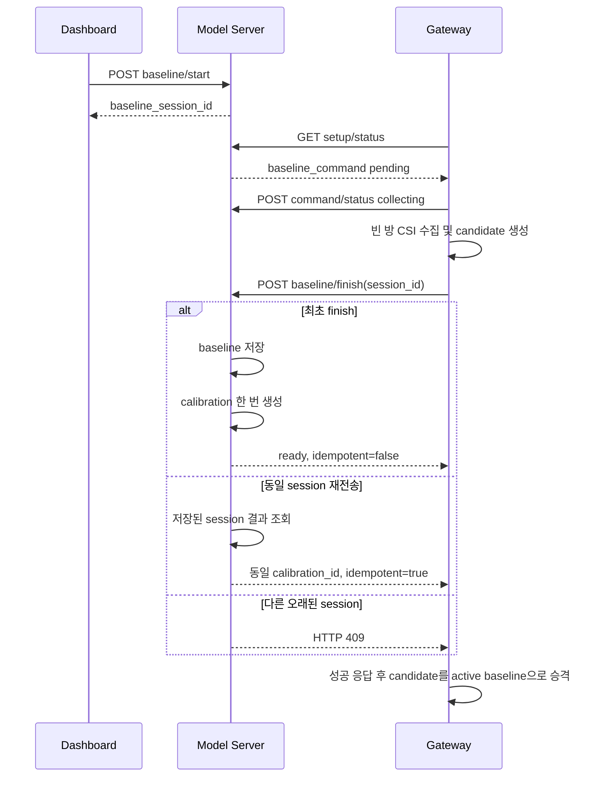

# Model Server 베이스라인 재수집 연동 요청

## 1. 목적

Gateway에서 같은 `BASELINE_ID`를 사용해 베이스라인을 재수집할 때도
새로운 수집 세션의 결과가 Model Server에 정상 반영되고, 네트워크 오류로
동일한 finish 요청이 재전송되더라도 중복 calibration이 생성되지 않도록
Gateway와 Model Server 사이의 멱등 계약을 정리한다.

검토 기준:

- Gateway: `71c811a` 기반 `codex/dashboard-baseline-control`
- Model Server: `2e50914` 기준 `main`

## 2. 확인된 문제

### 2.1 Gateway의 기존 동작

기존 Gateway는 서버의 `baseline_id`가 전송하려는 `baseline_id`와 같고
서버 상태가 `ready` 계열이면 `/baseline/finish`를 전송하지 않았다.

이 방식은 서로 다른 수집 세션에서도 같은 `BASELINE_ID`를 사용하면 새로
측정한 베이스라인이 서버에 전달되지 않을 가능성이 있다.

### 2.2 Model Server의 기존 동작

현재 Model Server에 동일한 `/baseline/finish` payload를 두 번 전송하면
각 요청에서 새로운 기본 calibration이 생성된다.

확인된 결과:

```text
첫 번째 finish  -> calib_<room>_baseline_default_v001
동일 finish 재전송 -> calib_<room>_baseline_default_v002
```

따라서 Gateway가 모든 finish를 무조건 재전송하는 방식만으로는 HTTP 응답
유실이나 timeout 이후 안전한 재시도를 보장할 수 없다.

## 3. Gateway 반영 내용

Gateway는 다음과 같이 수정되었다.

1. `baseline_id`만으로 finish를 생략하지 않는다.
2. 같은 `BASELINE_ID`라도 새로운 `baseline_session_id`면 finish를
   반드시 POST한다.
3. 동일한 `baseline_session_id`가 서버에서 이미 `completed`된 것이
   확인된 경우에만 exact retry로 간주해 POST를 생략한다.
4. 새 baseline은 session 디렉터리에 candidate로 먼저 저장한다.
5. 서버 finish 성공 후에만 candidate를 active `baseline_state.json`으로
   승격한다.
6. 서버 전송 실패 시 기존 active baseline을 유지하고 candidate와 finish
   payload를 setup spool에 보존한다.
7. spool 재시도 성공 시 candidate를 active baseline으로 승격한다.

추가된 주요 로그:

```text
baseline_finish_dispatching
baseline_finish_succeeded
baseline_finish_skipped_exact_retry
```

각 로그에는 다음 식별자가 포함된다.

```text
room_id
baseline_id
baseline_session_id
calibration_id
server_status
command_status
```

Gateway 전체 회귀 테스트:

```text
116 passed
git diff --check passed
```

## 4. Model Server 필수 변경 요청

### 4.1 멱등 키

`/api/rooms/{room_id}/baseline/finish`의 멱등 키는 다음 조합이어야 한다.

```text
(room_id, baseline_session_id)
```

`baseline_id`는 새 수집에서도 재사용할 수 있으므로 단독 멱등 키로
사용하면 안 된다.

### 4.2 finish 처리 규칙

| 조건 | 기대 동작 |
|---|---|
| 같은 room, 같은 session의 최초 finish | baseline 저장, calibration 생성 |
| 같은 room, 같은 session의 finish 재전송 | 기존 결과 반환, 새 calibration 생성 금지 |
| 같은 room, 같은 baseline ID, 새로운 session | 새로운 baseline으로 갱신하고 새 calibration 생성 |
| active command와 다른 오래된 session | HTTP 409 반환 |
| 존재하지 않는 room 또는 session | 정책에 따라 404 또는 409 반환 |

동일 session 재전송 시에는 최초 성공 응답과 동일한
`baseline_id`와 `calibration_id`를 반환해야 한다.

### 4.3 권장 finish 응답

```json
{
  "room_id": "room_101",
  "baseline_session_id": "base_room_101_20260727T120000000Z",
  "baseline_id": "baseline_room_101_v001",
  "calibration_id": "calib_room_101_baseline_default_v002",
  "calibration_method": "baseline_default_global_threshold",
  "status": "ready",
  "idempotent": false
}
```

동일 session 재전송 응답:

```json
{
  "room_id": "room_101",
  "baseline_session_id": "base_room_101_20260727T120000000Z",
  "baseline_id": "baseline_room_101_v001",
  "calibration_id": "calib_room_101_baseline_default_v002",
  "calibration_method": "baseline_default_global_threshold",
  "status": "ready",
  "idempotent": true
}
```

### 4.4 setup/status 계약

Gateway는 현재 exact retry 판별을 위해
`GET /api/rooms/{room_id}/setup/status`의 `baseline_command`를 사용한다.

최소 응답 구조:

```json
{
  "room_id": "room_101",
  "status": "ready",
  "baseline_id": "baseline_room_101_v001",
  "calibration_id": "calib_room_101_baseline_default_v002",
  "baseline_command": {
    "command_id": "base_room_101_20260727T120000000Z",
    "baseline_session_id": "base_room_101_20260727T120000000Z",
    "status": "completed"
  }
}
```

완료된 command를 즉시 제거하면 Gateway가 응답 유실 후 exact retry를
판별할 수 없다. Model Server가 finish endpoint 자체에서 session 기반
멱등성을 보장한 이후에도 상태 확인과 운영 추적을 위해 마지막 완료
command를 유지하는 것을 권장한다.

## 5. 권장 서버 처리 흐름



## 6. 서버 구현 시 주의점

### 6.1 완료된 session 검증

현재 구현은 command가 `pending` 또는 `collecting`일 때만
`baseline_session_id` 불일치를 검사한다. command가 `completed`된 뒤에도
다른 session의 오래된 finish가 기존 baseline을 덮어쓰지 못하도록 검증이
필요하다.

### 6.2 calibration 중복 생성 방지

`baseline/finish` 처리와 기본 calibration 생성은 하나의 논리적
트랜잭션이어야 한다.

동일 session이 이미 완료된 경우 다음 함수를 다시 실행하면 안 된다.

```text
create_default_calibration_profile(...)
```

session 결과에는 최소한 다음 정보를 저장해야 한다.

```text
room_id
baseline_session_id
baseline_id
calibration_id
status
completed_at
```

### 6.3 상태 영속화

현재 `StateStore`의 room, baseline, command, calibration 상태는 프로세스
메모리에 저장된다. 서버가 재시작되면 멱등 기록과 setup 상태가 함께
사라질 수 있다.

운영 환경에서는 다음 중 하나가 필요하다.

- 관계형 DB
- DynamoDB
- Redis와 영속 저장 조합
- 최소한의 파일 기반 atomic state store

서버 재시작 후에도 완료된 `baseline_session_id`와 그 결과
`calibration_id`를 조회할 수 있어야 한다.

### 6.4 command timeout

Gateway가 비정상 종료되면 `pending` 또는 `collecting` command가 계속
남아 이후 재수집 요청을 막을 수 있다.

권장 정책:

```text
pending timeout
collecting heartbeat timeout
명시적 cancel 또는 fail endpoint
```

## 7. Calibration finish에도 동일 원칙 적용

Gateway와 Model Server의 `calibration/finish`에도 유사한 문제가 있다.

권장 멱등 키:

```text
(room_id, calibration_session_id)
```

동일 calibration session의 finish 재전송은 기존 `calibration_id`를
반환하고 새 calibration profile을 생성하지 않아야 한다.

## 8. Static 검출 관련 추가 협의

현재 baseline finish 후 생성되는 기본 calibration은 baseline payload의
점수 요약을 threshold 계산에 사용하지 않고 global threshold를 사용한다.

따라서 베이스라인을 재수집해도 방이나 거리에 맞춘 Stage-1 threshold가
자동으로 바뀌지는 않는다. static 신호가 Stage-1 threshold를 넘지 못하면
Stage-2 static/moving CNN은 실행되지 않고 `empty`로 종료된다.

별도 협의가 필요한 선택지는 다음과 같다.

1. baseline summary 기반 room threshold 생성
2. 명시적인 empty calibration 수집을 필수화
3. global threshold와 room threshold의 하한/상한 정책 적용

이 항목은 finish 멱등성 수정과 별개로 다루되, static 미검출 개선을
위해서는 반드시 정책을 결정해야 한다.

## 9. 인수 테스트

Model Server 변경 완료 조건:

1. 같은 baseline ID와 새로운 session으로 finish하면 요청이 반영된다.
2. 동일 session finish를 두 번 보내도 calibration profile은 하나만
   생성된다.
3. 두 번째 응답의 `calibration_id`가 첫 번째 응답과 동일하다.
4. 두 번째 응답은 `idempotent=true`다.
5. active command와 다른 stale session은 409를 반환한다.
6. 서버 재시작 후 동일 session을 재전송해도 기존 결과가 반환된다.
7. Gateway가 finish 응답을 받지 못한 상황을 가정해 재시도해도 Gateway와
   Model Server의 baseline/calibration ID가 일치한다.
8. 새로운 baseline 성공 후 기존 calibration ID의 realtime payload는
   명확한 오류 코드로 거절된다.

## 10. 권장 배포 순서

1. Model Server에 session 기반 멱등 처리와 테스트를 먼저 배포한다.
2. `setup/status` 및 finish 응답 계약을 확인한다.
3. 수정된 Gateway를 배포한다.
4. 빈 방에서 baseline 재수집을 수행한다.
5. Gateway 로그에서 `baseline_finish_succeeded`를 확인한다.
6. 같은 finish payload를 재전송해 `idempotent=true`와 동일한
   `calibration_id`를 확인한다.
7. realtime 전송을 재개하고 새로운 calibration ID로 HTTP 200을
   확인한다.
